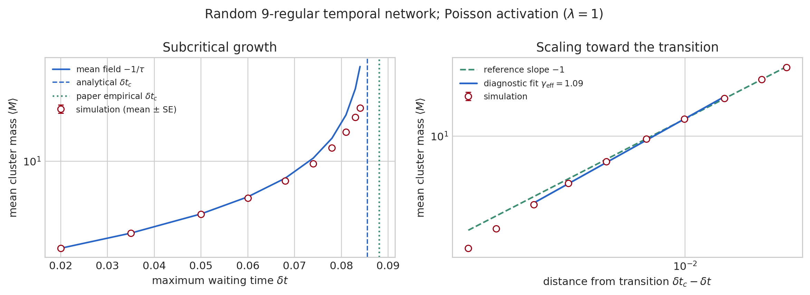
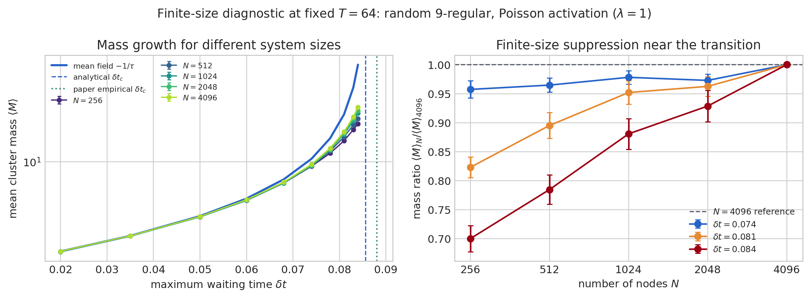

# Directed Percolation in Temporal Networks

**Physics of Complex Systems · MSc in Physics of Data · University of Padua**  
Chiara Tramarin

How does a limit on waiting time affect reachability in a temporal network?
This academic project explores the connection between temporal paths and directed
percolation through a literature-based presentation and a Python computational
illustration.

[Read the final presentation](presentation/directed_percolation.pdf) ·
[Computational methods and reproduction commands](computational/README.md)

## Project overview

The presentation discusses event graphs, absorbing-state transitions, mean-field
theory and critical behaviour, following the papers cited below. The accompanying
code generates random regular networks with Poisson edge activations and measures
the mean number of events reachable under a maximum waiting-time constraint.

The repository contains the project presentation, simulation implementation,
saved numerical results and a finite-size diagnostic. The underlying theory and
published reference thresholds are attributed to Badie-Modiri and co-authors;
this project is an educational study, not a claim of a new theoretical result.

**Methods and tools:** Python, NumPy, Matplotlib, random graph generation,
stochastic simulation, graph traversal, uncertainty estimation and scientific
visualisation.

## Results



For a random 9-regular network with 4,096 nodes, the saved run averages over
128 realisations and 1,024 source events per realisation. The mean reachable
cluster mass increases from approximately **1.45 to 32.52** across the sampled
waiting-time range (0.020–0.084). Parameters, seeds and diagnostics are recorded
in [run metadata](computational/results_high_statistics/run_metadata.json).



The comparison covers 256–4,096 nodes at a fixed observation duration of 64.
It illustrates finite-size suppression near the transition. This is a qualitative
computational illustration: it is **not a full finite-size-scaling analysis or a
precision measurement of a critical exponent**. The largest system uses the
128-realisation run above; the smaller systems use 64 realisations each.

## Quick start

Use **Python 3.10 or later**. The dependencies are pinned to the versions used
for the local packaging checks (Python 3.10.12).

From the repository root:

```bash
python3 -m venv .venv
source .venv/bin/activate
python -m pip install -r requirements.txt
python computational/simulate_cluster_mass.py \
  --nodes 128 --duration 32 --realisations 2 --sources 64 \
  --output-dir computational/results_smoke
```

On Windows, activate the environment with `.venv\Scripts\activate` instead.
The simulation writes CSV data, PNG/PDF plots and JSON metadata. This small run
checks the workflow; it does not reproduce the statistics of the saved figures.

To regenerate the combined finite-size plot from the included datasets:

```bash
python computational/finite_size_diagnostic.py
```

With the default parameters, the existing datasets are reused. See the
[computational README](computational/README.md) for the longer simulation command
used to generate the presentation result and for modelling limitations.

## Repository contents

- `presentation/directed_percolation.pdf`: final presentation (v4).
- `computational/simulate_cluster_mass.py`: network generation and cluster-mass simulation.
- `computational/finite_size_diagnostic.py`: system-size comparison.
- `computational/results_high_statistics/`: presentation figure, data and metadata.
- `computational/results_finite_size/`: combined figure and numerical inputs for each size.

## References

1. A. Badie-Modiri, A. K. Rizi, M. Karsai and M. Kivelä,
   *Directed percolation in temporal networks*, Physical Review Research **4**,
   L022047 (2022). [Paper](https://doi.org/10.1103/PhysRevResearch.4.L022047).
2. A. Badie-Modiri, A. K. Rizi, M. Karsai and M. Kivelä,
   *Directed percolation in random temporal network models with heterogeneities*,
   Physical Review E **105**, 054313 (2022).
   [Paper](https://doi.org/10.1103/PhysRevE.105.054313).

The presentation includes discussion of these works and attributed reference
material. Paper PDFs are not redistributed in this repository.
